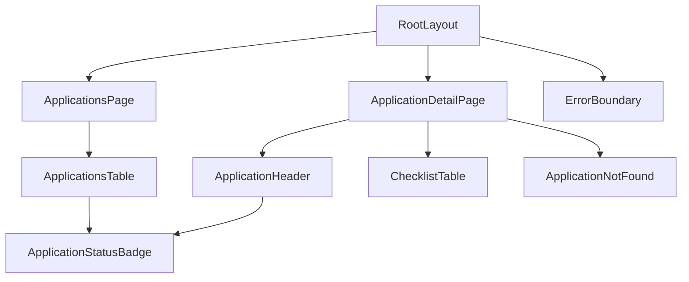

# ui-contract

Client-facing units for [view-applications](view-applications.md). Both pages are React Server Components that call the [read queries](backend-contract.md#unit-4-read-queries--listapplications-getapplication) directly. There is no client-side fetching and no API route. The project runs Next.js 16 with `cacheComponents` on (the scaffold default). Reads are uncached and run at request time inside the Suspense boundary that each route's `loading.tsx` provides, so a refresh always shows the current CSV. Don't add `"use cache"`. Don't export `dynamic`: it is removed under `cacheComponents` (see `node_modules/next/dist/docs/01-app/03-api-reference/03-file-conventions/02-route-segment-config/index.md`). Note that Next keeps up to 3 visited routes mounted (React `<Activity>`), so returning to one can show it instantly with no loading phase.

The audience is non-technical ([Technical Context](research-notes.md#technical-context)): plain tables, plain words, no jargon. Statuses read exactly as stored.

## Component Decomposition

| Component | Route / file | Responsibility |
|---|---|---|
| RootLayout | `src/app/layout.tsx` | App title "Loan Document Tracker", a link home, base styles |
| ApplicationsPage | `src/app/page.tsx` (`/`) | Calls `listApplications`; renders the total line ("60 applications") and the table, or the empty message |
| ApplicationsTable | `src/components/ApplicationsTable.tsx` | One row per application, including a Documents column (`documentCount` of 12, e.g. "9 of 12"); the whole row links to `/applications/<id>` |
| SortableColumnHeader | `src/components/SortableColumnHeader.tsx` (`"use client"`) | Header cell for Application, Business and Applied: a `Link` to `/?sort=<column>&dir=<next>`, both ▲ and ▼ arrows on every sortable header (active or greyed out, see [Sortable columns](#sortable-columns-)), `aria-sort` on the active column, and the Loader while its navigation is pending (`useLinkStatus`). Other headers stay plain text |
| PaginationControls | `src/components/PaginationControls.tsx` | Below the table: a ‹ Previous arrow, "Page N of M", and a Next › arrow. An arrow that can move is a `Link` with the pending Loader (reuse `src/components/SortPendingLoader.tsx`); an arrow that can't is a disabled `<button>`. Hidden in the Empty state |
| ApplicationStatusBadge | `src/components/ApplicationStatusBadge.tsx` | "Complete" (success style) or "N outstanding" (warning style) |
| ApplicationDetailPage | `src/app/applications/[id]/page.tsx` | Calls `getApplication`; `notFound()` on null |
| ApplicationHeader | `src/components/ApplicationHeader.tsx` | Business, borrower, amount, processor, application date, badge |
| ChecklistTable | `src/components/ChecklistTable.tsx` | 12 rows: type, status (renders `item.status`, so "Not Started" and "Not on checklist" come from the backend), date received, expiration date, notes |
| ApplicationNotFound | `src/app/applications/[id]/not-found.tsx` | "Application not found" + link back to the list |
| Loader | `src/components/Loader.tsx` | Spinner + text label (`role="status"`, `aria-live="polite"`); rendered by every `loading.tsx` |
| ErrorBoundary | `src/app/error.tsx` | "An error has occurred" + a "Try again" button; never shows the error message itself (Q19) |

**Extension points** used by the sibling paths: ApplicationsPage gets an "Add application" link from [add-application](../add-application/ui-contract.md#component-decomposition). ChecklistTable gets a per-row Edit control from [update-document-status](../update-document-status/ui-contract.md#component-decomposition). Leave room for them, but don't build them here.

## State Machines

### Applications list (/)

| State | Entered when | Renders |
|---|---|---|
| Loading | first load or any navigation to `/` | `loading.tsx` renders Loader "Loading applications…" |
| Populated | `listApplications` returns ≥ 1 | Total line (all applications) + the current page's table (up to 10 rows, one per application ID), ordered by the current sort; see [Pagination](#pagination-) |
| Empty | it returns [] (header-only or zero-byte CSV) | "No open applications to display"; no table and no total line |
| Failed | it throws `CsvDataError` | ErrorBoundary: "An error has occurred" (HTTP 200, Q20) |

Events: `ROW_CLICK` (Populated → navigate to detail); `RETRY` (Failed → re-render via `reset()`).

### Sortable columns (/)

Added 2026-10-15 (Q23–Q26). The `/` page reads `searchParams`, calls `parseApplicationSort` and passes the result to `listApplications` and to the headers ([Unit 5](backend-contract.md#unit-5-sort-parsing-and-ordering--parseapplicationsort-compareapplications)). The URL is the only sort state; there's none in React state.

| State | Entered when | Renders |
|---|---|---|
| Sorted | the page renders with a parsed sort | Every sortable header shows ▲▼. The active column has `aria-sort="ascending"` or `"descending"`, and its arrow for the current direction is active (dark) while the other is inactive (greyed out). The other sortable headers have both arrows inactive and `aria-sort="none"` (revised 2026-10-15, Q33) |
| SortPending | a sortable header is clicked and the new render hasn't arrived | Loader "Loading applications…" is visible; the old table may stay underneath |

Arrow states (Q33):

| Header | ▲ | ▼ |
|---|---|---|
| Sorted column, ascending | active | inactive |
| Sorted column, descending | inactive | active |
| Unsorted sortable column | inactive | inactive |
| Non-sortable column | none | none |

Each arrow is its own element with id `sort-arrow-<column>-<asc|desc>` and `data-state="active"` or `"inactive"`, inside the existing `sort-indicator-<column>` wrapper, which now renders on every sortable header. Inactive uses the muted text colour; active uses the normal text colour. Both arrows stay `aria-hidden`, since `aria-sort` is what screen readers announce.

Events: `HEADER_CLICK(column)`. If `column` is the active column, navigate to the same column with the opposite direction; otherwise navigate to `column` ascending. Sorted → SortPending → Sorted.

Guards:
- Invalid, empty or missing `sort`/`dir` in the URL render exactly like the default (Application ▲). The URL is not rewritten (ASSUMED — confirm with user).
- Sorting never changes the total line or the page count.
- The pending Loader is required because a same-route navigation that only changes the query string doesn't show `loading.tsx`. Next keeps the old content on screen with no pending signal (`node_modules/next/dist/docs/01-app/02-guides/interactive-apps.md:206`).

### Pagination (/)

Added 2026-10-15 (Q27–Q31). The `/` page parses `searchParams.page` with `parsePageParam`, calls `listApplications(sort)`, then `paginate(applications, page)` ([Unit 6](backend-contract.md#unit-6-pagination--parsepageparam-paginate)), and renders `Page.items`. The URL is the only page state.

| State | Entered when | Renders |
|---|---|---|
| FirstPage | `page` is 1 and `totalPages` > 1 | Previous disabled; Next enabled; "Page 1 of M" |
| MiddlePage | 1 < `page` < `totalPages` | Both arrows enabled; "Page N of M" |
| LastPage | `page` is `totalPages` and `totalPages` > 1 | Previous enabled; Next disabled; "Page M of M" |
| SinglePage | `totalPages` is 1 (1–10 applications) | Both arrows disabled; "Page 1 of 1" (ASSUMED: the controls show rather than hide) |
| PagePending | an enabled arrow is clicked and the new render hasn't arrived | Loader "Loading applications…" |

Events:
- `NEXT`: navigate to `page + 1`. `PREVIOUS`: navigate to `page − 1`. Both keep the current `sort` and `dir`.
- `HEADER_CLICK` (from [Sortable columns](#sortable-columns-)): the sort link drops `page`, so a new sort always starts on page 1 (Q31).

Guards:
- The total line still shows **all** applications ("60 applications"), not the 10 on screen.
- Invalid, empty or past-the-end `page` values render page 1, or the last page for past-the-end, and never error. The URL is not rewritten (ASSUMED, the same as sorting).
- A disabled arrow is a real disabled `<button>`, not a link, so it can't be clicked or tab-focused into a navigation.

### Application detail (/applications/[id])

| State | Entered when | Renders |
|---|---|---|
| Loading | any navigation to `/applications/[id]` | `loading.tsx` renders Loader "Loading application…" |
| Found | `getApplication` returns detail | Header + 12-row checklist |
| NotFound | it returns null | ApplicationNotFound |
| Failed | it throws `CsvDataError` | ErrorBoundary: "An error has occurred" |

Inside Found, each checklist row is one of: **Present** (row exists: status, dates and notes as stored, blank cells shown empty); **NotStarted** (row exists with a blank status: the status cell reads "Not Started"); or **Missing** (row is null: the status cell reads "Not on checklist" in muted style, other cells empty).

## I/O Samples

**List row**, from the sample CSV:

Above the table: "60 applications".

| Application | Business | Borrower | Loan amount | Processor | Applied | Documents | Status |
|---|---|---|---|---|---|---|---|
| APP-2026-1001 | Metro Dental Group | Elena Williams | $390,000.00 | Aisha Patel | 12/1/2025 | 9 of 12 | 10 outstanding |

**Detail page for APP-2026-1001**: the header shows "Metro Dental Group · Elena Williams · $390,000.00 · Aisha Patel · Applied 12/1/2025 · 10 outstanding". Checklist excerpt:

| Document | Status | Received | Expires | Notes |
|---|---|---|---|---|
| Bank Statements (90 day) | Under Review | 1/28/2026 | 4/28/2026 | Reviewing for completeness |
| Debt Schedule | Not on checklist | | | |
| Ownership Verification | Approved | 1/20/2026 | | |

**User visits** `/applications/APP-2026-9999` → "Application not found", with a "Back to applications" link.

## Test Cases — UI

Cypress specs. Each spec resets a fixture CSV via a `cy.task` that copies a known file to `DATA_CSV_PATH` before the test. The dev server must start with that env var.

### Acceptance tests (user-specified)

These are the same seven tests as the [backend acceptance tests](backend-contract.md#acceptance-tests-user-specified), asserted in the browser (Q22). They are the done-criteria for the UI run. Write them first and confirm each fails for the right reason (the page or element doesn't exist yet, not a Cypress or server setup problem) before implementing.

| # | User's test | Page | Fixture → what the user sees |
|---|---|---|---|
| 1 | We can read the CSV | `/` | Sample copy → the table renders application rows from the file; the first row is APP-2026-1001, Metro Dental Group, Elena Williams, $390,000.00, Aisha Patel, 12/1/2025 |
| 2 | Count of the total number of applications | `/` and `?page=1..6` | Sample copy → "60 applications" above the table and 10 rows on page 1; pages 1–6 together show all 60 application IDs, each exactly once (revised 2026-10-15, Q32) |
| 3 | Count of the documents for each application | `/` | Sample copy → APP-2026-1001's Documents cell reads "9 of 12"; an application with 12 rows reads "12 of 12" |
| 4 | Status of all documents under an application | `/applications/APP-2026-1001` | Sample copy → 12 checklist rows in alphabetical order; Ownership Verification "Approved", Bank Statements (90 day) "Under Review", Lease Agreement "Pending" |
| 5 | An application missing documents is still returned | `/` and detail | Sample copy → APP-2026-1001 (9 rows) is listed; its detail page shows "Not on checklist" for Debt Schedule, SBA Form 1919 and SBA Form 912 |
| 6 | A document without a status shows Not Started | detail | Builder fixture with one blank `document_status` → that checklist row reads "Not Started", and the header badge counts it as outstanding |
| 7 | No applications → "No open applications to display" | `/` | Header-only fixture → that message, with no table and no total line |

### Acceptance tests — sorting (user-specified)

Done-criteria for the UI sorting run (Q23, Q25). These are the same tests as the [backend sorting tests](backend-contract.md#acceptance-tests--sorting-user-specified), asserted in the browser. Write them first and confirm each fails for the right reason (the header isn't a link yet, or the order is unchanged) before implementing. Expected orders are in the backend contract's [I/O Samples](backend-contract.md#io-samples).

| # | User's test | Action | Fixture → what the user sees |
|---|---|---|---|
| S1 | Sort by each column, ascending | Click Application, Business, Applied (each from the default page; Application is clicked twice: once to desc, once back to asc) | Sample copy → the URL has `sort=<column>&dir=asc`; the first rows on page 1 and the last row on `&page=6` match the order table; the header's ▲ is active and its ▼ inactive, all other sortable headers have both arrows inactive, `aria-sort="ascending"` (revised, Q32, Q33) |
| S2 | Sort by each column, descending | Click the active column's header again | Sample copy → `dir=desc`; the first rows on page 1 and the last row on `&page=6` match; ▼ active and ▲ inactive, `aria-sort="descending"`, other sortable headers both inactive (Q33); the tied dates stay ID ascending (revised, Q32) |
| S3 | The total doesn't change with the sort | Each of the 6 sorts | Sample copy → "60 applications", "Page 1 of 6" and 10 rows every time (revised, Q32) |
| S4 | Invalid sort and dir values fall back | Visit `/?sort=status&dir=up` and `/?sort=Business` | Sample copy → default order (APP-2026-1001 first), Application ▲ active (every other arrow inactive, Q33), 10 rows, "Page 1 of 6" (revised, Q32) |
| S5 | Empty or missing sort and dir fall back | Visit `/?sort=&dir=` and `/` | Sample copy → default order, Application ▲ active (every other arrow inactive, Q33), 10 rows, "Page 1 of 6" (revised, Q32) |

### Acceptance tests — sort arrows

Done-criteria for the sort-arrow run (Q33). Write them first and confirm each fails for the right reason (no `sort-arrow-*` elements yet, or unsorted headers still showing no arrows) before implementing. The shared `expectSortIndicator` helper in `cypress/e2e/view-applications.cy.ts` currently asserts that unsorted columns have **no** indicator. It must be redefined to the arrow-state table above, and every spec that calls it keeps passing.

| # | Test | Action | Fixture → what the user sees |
|---|---|---|---|
| A1 | Both arrows always show on sortable headers | Visit `/`, `/?sort=business&dir=asc`, `/?sort=applied&dir=desc&page=3` | Sample copy → Application, Business and Applied each have `sort-arrow-<column>-asc` (▲) and `sort-arrow-<column>-desc` (▼) |
| A2 | The current direction is active on the sorted column | Visit `/?sort=business&dir=asc` | Business ▲ `data-state="active"`, Business ▼ `"inactive"` |
| A3 | Unsorted sortable columns are fully greyed out | Same visit | Application and Applied: both arrows `"inactive"` |
| A4 | Toggling flips the active arrow | On `/?sort=business&dir=asc`, click Business | URL `dir=desc`; Business ▼ `"active"`, ▲ `"inactive"` |
| A5 | The default sort lights Application ▲ | Visit `/`, `/?sort=&dir=`, `/?sort=status&dir=up` | Application ▲ `"active"`; every other arrow `"inactive"` |
| A6 | Non-sortable headers have no arrows | Visit `/` | Borrower, Loan amount, Processor, Documents and Status contain no ▲ or ▼ and no `sort-arrow-*` element |
| A7 | Greyed out is visibly different | Visit `/` | The computed `color` of Application ▲ (active) differs from Application ▼ (inactive) |

### Acceptance tests — pagination (user-specified)

Done-criteria for the UI pagination run (Q27–Q31). These are the same tests as the [backend pagination tests](backend-contract.md#acceptance-tests--pagination-user-specified), asserted in the browser. Write them first and confirm each fails for the right reason (no pagination controls yet, or 60 rows still showing) before implementing. Expected pages are in the backend contract's [I/O Samples](backend-contract.md#io-samples).

| # | User's test | Action | Fixture → what the user sees |
|---|---|---|---|
| P1 | We can paginate to the end of the list | From `/`, click Next until it is disabled | Sample copy → 10 rows per page; "Page 6 of 6" after 5 clicks; the last row is APP-2026-1060; the URL ends `page=6`. The 23-application builder fixture → "Page 3 of 3" holds 3 rows |
| P2 | We can't paginate before page 1 | On `/`, try Previous; visit `/?page=0` and `/?page=-1` | Previous is disabled and clicking it does nothing (the URL is unchanged); both URLs show "Page 1 of 6" with APP-2026-1001 first |
| P3 | Arrows disabled at the ends | Pages 1, 3 and 6, and a 7-application fixture | Page 1: Previous disabled, Next enabled. Page 3: both enabled. Page 6: Previous enabled, Next disabled. Single page: both disabled, "Page 1 of 1" |
| P4 | Valid page values | Visit `/?page=2`, `/?page=99`, `/?sort=business&dir=asc&page=2` | Page 2: APP-2026-1011 → APP-2026-1020. Page 99: "Page 6 of 6", APP-2026-1051 first. Business page 2: APP-2026-1032 first, APP-2026-1036 last, Business ▲ |
| P5 | Empty page values | Visit `/?page=` and `/` | "Page 1 of 6", APP-2026-1001 first |
| P6 | Invalid page values | Visit `/?page=abc`, `/?page=2.5`, `/?page=02` | "Page 1 of 6", APP-2026-1001 first, no error |

### Further UI tests

Since pagination (Q32), any spec that waits for the list to render waits for `PAGE_SIZE` (10) rows on page 1, not for every application.

- **List populated**: a fixture with 3 apps whose document rows are interleaved in the file shows "3 applications" and exactly 3 rows in ID order, with all 8 columns; an app with 9 rows shows "9 of 12".
- **Empty**: a header-only fixture shows "No open applications to display" with no table.
- **Failed**: a fixture with a bad header shows "An error has occurred", and no header or path text appears on the page.
- **Currency**: `390000` shows `$390,000.00`; `12500.5` shows `$12,500.50`.
- **Status badges**: in a fixture app with all 12 types Approved/Not Required the badge reads "Complete"; in an app with 9 rows (2 Approved) it reads "10 outstanding".
- **Navigate**: clicking a row lands on `/applications/<id>`.
- **Detail checklist**: exactly 12 rows in alphabetical order; a missing type shows "Not on checklist"; a blank-status row shows "Not Started"; present rows show stored status, dates and notes.
- **Not found**: an unknown ID shows "Application not found"; the back link returns to `/`.
- **Loader, list → detail**: delay the detail route's server response (`cy.intercept` on the RSC request), click a row → Loader "Loading application…" is visible, then disappears when the checklist renders.
- **Loader, detail → list**: same technique on the back link → Loader "Loading applications…" is visible until the table renders.
- **Sort loader**: delay the RSC response for `/?sort=business&dir=asc` (`cy.intercept`), click Business → Loader "Loading applications…" is visible until the re-sorted table renders.
- **Non-sortable headers**: Borrower, Loan amount, Processor, Documents and Status are plain text, not links.
- **Sort survives reload**: reload on `/?sort=applied&dir=desc` → the same order and indicator.
- **Page loader**: delay the RSC response for `page=2`, click Next → Loader "Loading applications…" is visible until page 2 renders.
- **Sort keeps working with pages**: on `/?page=3`, click Business → the URL has `sort=business&dir=asc` and no `page`; "Page 1 of 6".
- **Arrows keep the sort**: on `/?sort=applied&dir=desc`, click Next → the URL has `sort=applied&dir=desc&page=2`; the first row is the 11th of that order.
- **Total unchanged**: on every page the total line reads "60 applications".
- **Empty list**: a header-only fixture shows no pagination controls.
- **No writes**: after visiting both pages, the fixture file is byte-identical (`cy.readFile` before and after).

## File Manifest — UI

| Group | File | Purpose |
|---|---|---|
| Layout | `src/app/layout.tsx`, `src/app/globals.css` | Title, nav link, minimal styles (plain CSS; no UI library needed) |
| List | `src/app/page.tsx`, `src/app/loading.tsx` | List page + loading state |
| Loader | `src/components/Loader.tsx` | Shared spinner + label |
| Detail | `src/app/applications/[id]/page.tsx`, `loading.tsx`, `not-found.tsx` | Detail page, loading, 404 |
| Errors | `src/app/error.tsx` | Client error boundary with retry |
| Sorting | `src/app/page.tsx`, `src/components/ApplicationsTable.tsx`, `src/components/SortableColumnHeader.tsx` | Read `searchParams`, parse, pass to the query and headers |
| Components | `src/components/ApplicationsTable.tsx`, `ApplicationStatusBadge.tsx`, `ApplicationHeader.tsx`, `ChecklistTable.tsx` | See Component Decomposition |
| Test setup | `cypress.config.*`, `cypress/support/*`, `cypress/fixtures/*.csv`, `cypress/e2e/view-applications.cy.ts` | `cy.task` for resetting the fixture CSV |

## Tasks — UI

### Task 1: Applications list page

Implements the [Applications list](#applications-list-) machine: Loading, Populated and Failed. This is where users answer "which applications still have outstanding documents?"

- [x] **Done**
- **Who**: UI.
- **What**: Build the root layout, list page, ApplicationsTable, ApplicationStatusBadge, the shared Loader and the list `loading.tsx`, the error boundary, plus the Cypress setup with fixture reset.
- **Why**: The list, total, Documents column, grouping, status, ordering, currency, empty, error and loader criteria in [Acceptance Criteria](view-applications.md#acceptance-criteria).
- **When**: First UI task.
- **Where**: `src/app/layout.tsx`, `src/app/page.tsx`, `src/app/loading.tsx`, `src/app/error.tsx`, `src/components/Loader.tsx`, `src/components/ApplicationsTable.tsx`, `src/components/ApplicationStatusBadge.tsx`.
- **How**: A server component calls `listApplications`; currency via `Intl.NumberFormat('en-US', currency USD, 2 fraction digits)`.

### Task 2: Application detail page

Implements the [Application detail](#application-detail-applicationsid) machine: Found (with Present and Missing rows), NotFound and Failed. This is the page the update path adds edit controls to.

- [x] **Done**
- **Who**: UI.
- **What**: Build the detail page, ApplicationHeader, ChecklistTable, the not-found page and the detail `loading.tsx` (reusing Loader).
- **Why**: The detail, "Not on checklist", "Not Started" and not-found criteria in [Acceptance Criteria](view-applications.md#acceptance-criteria).
- **When**: After Task 1 (reuses the badge and the Cypress setup).
- **Where**: `src/app/applications/[id]/page.tsx`, `src/app/applications/[id]/not-found.tsx`, `src/app/applications/[id]/loading.tsx`, `src/components/ApplicationHeader.tsx`, `src/components/ChecklistTable.tsx`.
- **How**: A server component calls `getApplication(params.id)`; on null it calls `notFound()`.

### Task 3: Sortable column headers

Implements the [Sortable columns](#sortable-columns-) machine (Sorted ↔ SortPending) on the [Applications list](#applications-list-): the Application, Business and Applied headers become links that drive the server-side sort through the URL.

- [x] **Done**
- **Who**: UI.
- **What**: Read `searchParams` on `/`, parse them with `parseApplicationSort`, pass the result to `listApplications` and to the new SortableColumnHeader cells (indicator, `aria-sort`, pending Loader).
- **Why**: Acceptance tests S1–S5 and the sorting criteria in [Acceptance Criteria](view-applications.md#acceptance-criteria).
- **When**: After Task 1. Needs backend Task 6 to finish first.
- **Where**: `src/app/page.tsx`, `src/components/ApplicationsTable.tsx`, `src/components/SortableColumnHeader.tsx`, `cypress/e2e/view-applications.cy.ts`.
- **How**: Under `cacheComponents`, await `searchParams` inside the existing Suspense boundary (read `node_modules/next/dist/docs/01-app/03-api-reference/03-file-conventions/page.md` first). Use `useLinkStatus` from `next/link` for the pending state. Build the hrefs with `ROUTES` and the `SortColumn`/`SortDirection` enums, never string-built keys.

### Task 4: Pagination controls

Implements the [Pagination](#pagination-) machine (FirstPage, MiddlePage, LastPage, SinglePage, PagePending) on the [Applications list](#applications-list-). The `/` page renders 10 rows at a time, and the arrows move through pages via the `page` URL param.

- [x] **Done**
- **Who**: UI.
- **What**: Parse `searchParams.page`, paginate the sorted list, render `Page.items`, and add PaginationControls. Extend `ROUTES` so arrow links keep `sort`/`dir` and sort links drop `page`.
- **Why**: Acceptance tests P1–P6 and the pagination criteria in [Acceptance Criteria](view-applications.md#acceptance-criteria).
- **When**: After Task 3. Needs backend Task 7 to finish first.
- **Where**: `src/app/page.tsx`, `src/components/PaginationControls.tsx`, `src/lib/ui/routes.ts`, `src/lib/ui/element-ids.ts`, `src/lib/ui/ui-text.ts`, `src/app/globals.css`, `cypress/e2e/view-applications.cy.ts`.
- **How**: Reuse `SortPendingLoader` for the arrows' pending state (consider renaming it to something generic, like `LinkPendingLoader`, since it now serves both). The total line takes `Page.totalCount`.

### Task 5: Both sort arrows on every sortable header

Changes the [Sortable columns](#sortable-columns-) Sorted state: every sortable header renders ▲ and ▼, active or inactive per the arrow-state table, instead of one arrow on the active column only.

- [x] **Done**
- **Who**: UI.
- **What**: Render both arrows with ids `sort-arrow-<column>-<asc|desc>` and `data-state`; style the inactive state greyed out; redefine `expectSortIndicator` and the header-text assertion (the interleaved-rows spec expects the header text "Application▲" today).
- **Why**: Acceptance tests A1–A7, the revised S1/S2/S4/S5 indicator checks, and the sort-arrow criterion in [Acceptance Criteria](view-applications.md#acceptance-criteria).
- **When**: After Task 4.
- **Where**: `src/components/SortableColumnHeader.tsx`, `src/lib/ui/ui-text.ts` (`SORT_INDICATORS`), `src/lib/ui/element-ids.ts`, `src/app/globals.css`, `cypress/e2e/view-applications.cy.ts`.
- **How**: No backend change; the parsed `ApplicationSort` already says which column and direction are active. Keep the arrows `aria-hidden`.
